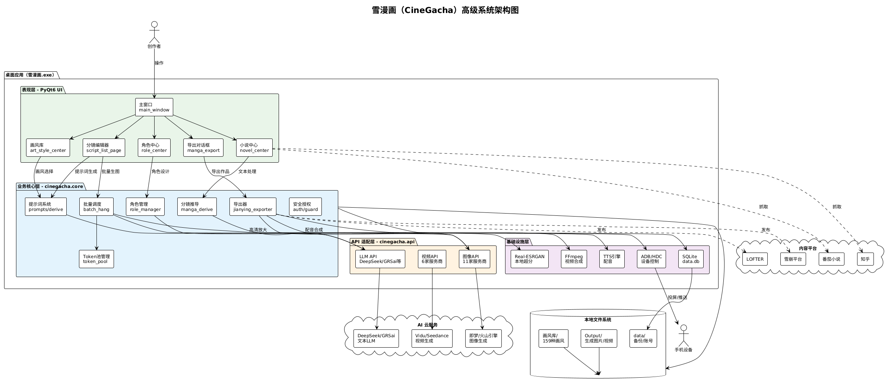
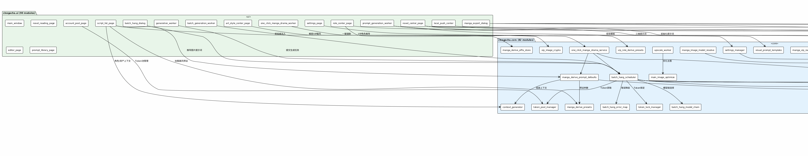
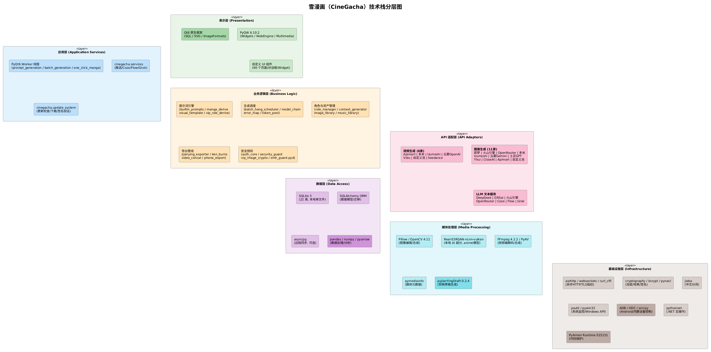
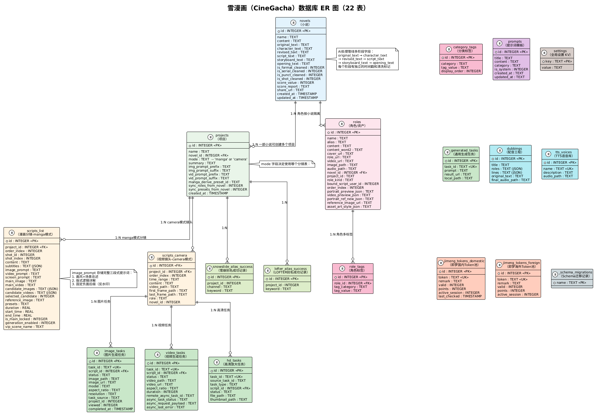
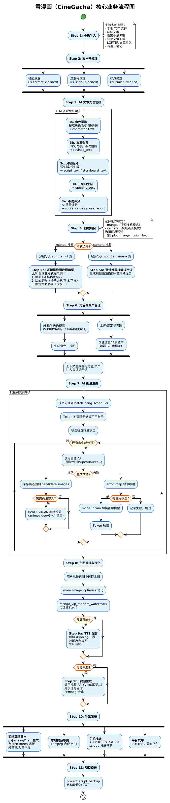

// [AGC:FILE] tool=Cc author=fangkun date=2026-08-15
# 项目架构分析：雪漫画（CineGacha）

> 版本：v1.8.16.26 ｜ 内部代号：cinegacha ｜ 分析日期：2026-08-15

---

## 一、执行摘要

**雪漫画**是一款面向网文漫改/短剧创作场景的 Windows 桌面应用，核心能力是将小说原文经 AI 流水线自动转化为**全彩条漫分镜图片**或**动漫短视频**。系统采用 PyQt6 构建 GUI，以 SQLite 做本地持久化，通过聚合多家 AI 图像/视频/LLM API 完成文生图、文生视频、角色设计、分镜推导、TTS 配音等工作，并支持导出剪映草稿、手机投屏发布。应用代码经 PyArmor 加密和自定义 Guard 模块保护，采用账号 Token 授权机制。

---

## 二、业务功能

### 2.1 核心业务流程

```
小说原文 → 文本清洗 → 角色提取 → 分镜拆分 → 画面提示词推导
    → AI 图片生成 → 高清放大 → TTS 配音 → 视频合成 → 剪映/本地导出
```

### 2.2 功能模块清单

| 功能域 | 说明 |
|--------|------|
| **小说中心** | 支持番茄小说、知乎、LOFTER、有道云笔记等平台内容抓取；本地 TXT 导入、粘贴录入；文本格式化清洗、标点修正、连载号清理 |
| **AI 文本处理** | 格式清洗 → 角色提取（character_text）→ 文案改写（revised_text）→ 分镜脚本（script_text/storyboard_text）→ 开场白（opening_text）→ 小说评分 |
| **角色管理** | AI 推导角色视觉描述（支持少年/成年等年龄段拆分）；角色三视图、形象视频生成；参考图绑定；道具/场景资产库 |
| **分镜编辑器** | 两种模式：manga（漫画多格）和 camera（视频镜头）；逐镜编辑画面内容、提示词、参考图、备选图；分镜对比 |
| **图片生成** | 18+ AI 图像服务商接入（即梦、火山引擎、OpenRouter、多米、云雾 Gemini 等）；Token 池管理、账号池、批量生成、错误映射与模型链降级 |
| **视频生成** | 即梦、Vidu、Seedance、多米等视频服务商；异步任务轮询；首尾帧控制 |
| **高清放大** | 内置 Real-ESRGAN-ncnn-vulkan，提供 animevideov3-x4 和 x4plus-anime 两种模型 |
| **画风库** | 159 种预设画风（3D/日系/插画/欧美/国风/韩系/Q版/IP/漫画专属）；VIP 加密自定义画风包（cg2 加密） |
| **TTS 配音** | 配音工程管理、多角色台词分配、语音库管理 |
| **视频导出** | FFmpeg 本地合成；pyJianYingDraft 剪映草稿生成（含 Ken Burns 运镜）；ADB/HDC 手机推送 |
| **发布集成** | LOFTER、雪崩（snowslide）平台登录与别名管理；新闻排行榜导入 |
| **一键漫剧** | 端到端自动化：小说 → 分镜 → 图片 → 配音 → 视频，全流程无人值守 |
| **安全授权** | 用户协议确认、License 激活（Fernet 加密本地存储）、PyArmor 代码保护、xmh_guard 原生模块、完整性校验、机器指纹（MAC/IP） |

### 2.3 两种创作模式

| 模式 | 数据库表 | 特点 |
|------|----------|------|
| **manga（漫画模式）** | `scripts_list` | 多格构图（主格+碎格），支持版式说明、旁白框、字框样式、候选图选择、VIP 随机水印 |
| **camera（视频模式）** | `scripts_camera` | 单镜头叙事，支持首尾帧、时间轴、视频任务、高清任务 |

---

## 三、技术栈

### 3.1 运行时与框架

| 类别 | 技术 | 版本/说明 |
|------|------|-----------|
| 语言 | Python | 3.9 (cp39-win_amd64) |
| GUI 框架 | PyQt6 | 6.10.2（含 Qt6 WebEngine、Multimedia） |
| 打包 | PyInstaller | onedir 模式 |
| 代码保护 | PyArmor | runtime 015151 |
| 原生保护 | xmh_guard.pyd | 自定义 C 扩展 Guard 模块 |

### 3.2 数据层

| 类别 | 技术 | 用途 |
|------|------|------|
| 本地数据库 | SQLite | 主数据存储（22 表，356KB） |
| ORM | SQLAlchemy | 数据访问层 |
| 异步 PG | asyncpg | 远程同步（可选） |
| 数据处理 | pandas 2.2.3 + numpy 1.26.4 + pyarrow | 表格/数值/列式处理 |

### 3.3 网络与 API 集成

| 类别 | 技术 |
|------|------|
| 异步 HTTP | aiohttp, httptools, curl_cffi（浏览器指纹模拟） |
| WebSocket | websockets, websocket_client |
| HTML 解析 | BeautifulSoup4, lxml, html2text |
| 中文分词 | jieba |
| 数据校验 | pydantic, pydantic_core |
| 加密 | cryptography 44.0, bcrypt, pynacl |

### 3.4 媒体处理

| 类别 | 技术 |
|------|------|
| 图像处理 | Pillow (PIL), OpenCV (cv2) 4.11 |
| AI 超分 | Real-ESRGAN-ncnn-vulkan（animevideov3-x4, x4plus-anime） |
| 视频处理 | FFmpeg 4.2.2（avcodec-58/avformat-58/avfilter-7） |
| 媒体信息 | pymediainfo |
| 视频导出 | pyJianYingDraft 0.2.4（剪映草稿） |
| 音视频编解码 | PyAV (av) |

### 3.5 设备与平台集成

| 类别 | 技术 |
|------|------|
| Android 控制 | ADB（adb.exe） |
| 鸿蒙控制 | HDC（hdc.exe） |
| 手机投屏 | scrcpy v3.3.4（含 SDL2/SDL3） |
| .NET 互操作 | pythonnet + clr_loader |
| 系统监控 | psutil, pywin32 |

### 3.6 AI 服务商接入

**图像生成（11 家）：**
即梦（Jimeng）、火山引擎（Volcengine）、多米（Duomi）、Uumoshi、Apimart、OpenRouter、云雾 Gemini（Yunwu）、土豆 GPT、Yhui Cloud、CloseAI、自定义池（Custom Pool）

**视频生成（6 家）：**
Apimart、Duomi、Uumoshi、云雾 OpenAI、Vidu、Custom Pool；另有 Seedance 分镜 Agent

**LLM 文本服务：**
DeepSeek、GRSai、火山引擎、OpenRouter、Coze、Flow、Grok、Gemini Local Flow

---

## 四、技术-问题映射

| 技术 | 解决的业务问题 | 解决的技术问题 | 未选替代方案 |
|------|---------------|---------------|-------------|
| **PyQt6** | 提供专业级桌面创作工具 UI | 跨平台原生窗口、富文本编辑器、WebEngine 嵌入、多媒体播放 | Electron（内存占用大）、Tkinter（控件贫乏） |
| **SQLite** | 零配置本地项目存储 | 单文件嵌入式数据库，无需安装服务，便于备份和迁移 | PostgreSQL/MySQL（需独立部署） |
| **PyArmor + xmh_guard** | 保护付费软件知识产权 | 字节码加密、运行时解密、防调试、完整性校验 | 纯 PyInstaller（易反编译） |
| **aiohttp + asyncio** | 同时调用多家 AI API | 异步并发请求、连接池、超时控制 | requests（同步阻塞，批量生成效率低） |
| **curl_cffi** | 绕过 Cloudflare 等反爬 | 模拟浏览器 TLS 指纹 | 标准 requests（TLS 指纹易被识别） |
| **Real-ESRGAN-ncnn** | 本地动漫图片高清放大 | Vulkan GPU 加速、无云端依赖、动漫专用模型 | waifu2x（速度慢）、云端 API（成本高/隐私） |
| **FFmpeg** | 视频合成与格式转换 | 成熟的音视频处理管线 | MoviePy（性能差，依赖 FFmpeg） |
| **pyJianYingDraft** | 导出可二次编辑的剪映工程 | 直接生成剪映草稿 JSON，含 Ken Burns 运镜 | 仅导出 MP4（无法后续编辑） |
| **jieba** | 中文小说分词语义分析 | 中文 NLP 基础分词，支持自定义词典 | spaCy（中文支持弱） |
| **ADB/HDC/scrcpy** | 一键推送到手机预览/发布 | Android/鸿蒙设备控制、实时投屏 | 手动传输（效率低） |
| **Token 池管理** | 多账号轮换绕过频率限制 | 自动 Token 验证、积分查询、会话锁定 | 单账号（易触发限流） |
| **cg2 加密 VIP 画风包** | 保护付费画风资产 | AES/Fernet 加密提示词，运行时解密，.enc 文件隐藏 | 明文 JSON（易被盗用） |

---

## 五、架构概述

### 5.1 分层架构

系统采用经典的四层桌面应用架构：

1. **表现层（cinegacha.ui）**：90 个 PyQt6 页面/对话框/组件模块，含主窗口、小说中心、分镜编辑器、角色中心、画风库、设置页等
2. **服务层（cinegacha.services + cinegacha.api）**：后台推送服务、Coze/Grok/Flow LLM 客户端封装；18 个 AI API Provider 适配器
3. **核心层（cinegacha.core）**：82 个业务模块，涵盖提示词管理、分镜推导、角色管理、批量调度、Token 池、安全守卫、导出器等
4. **基础设施层（cinegacha.utils + cinegacha.update_system + cinegacha.resources）**：下载器、加密、日志、数据库迁移、文件操作、自动更新、静态资源

### 5.2 组件关系

```
用户操作 ─→ PyQt6 UI 层
                │
                ├── 小说导入/清洗 ──→ LLM API (DeepSeek/GRSai/...)
                ├── 角色设计 ──────→ 图像 API (即梦/火山/...)
                ├── 分镜推导 ──────→ LLM API + manga_derive_presets
                ├── 图片生成 ──────→ 图像 API 池（Token 轮换）
                ├── 高清放大 ──────→ Real-ESRGAN (本地 Vulkan)
                ├── TTS 配音 ─────→ TTS 服务
                ├── 视频合成 ──────→ FFmpeg (本地)
                └── 导出发布 ──────→ 剪映草稿 / ADB推送 / LOFTER API
                        │
                        ▼
                SQLite (data.db) + 文件系统 (Output/)
```

### 5.3 数据流

1. **输入阶段**：小说文本从文件粘贴/平台抓取进入 `novels.content`，经多阶段 AI 处理后分别存入 `original_text`、`character_text`、`revised_text`、`script_text`、`storyboard_text` 等字段
2. **项目创建**：`projects` 表关联 novel，选择模式（manga/camera）和画风预设（如 `plot_manga_fusion_bw`）
3. **分镜持久化**：manga 模式写入 `scripts_list`，camera 模式写入 `scripts_camera`；每条分镜含 content（画面内容）、image_prompt（完整提示词）、main_image（生成图路径）
4. **资产生成**：角色和道具存入 `roles` 表，标签通过 `role_tags`/`category_tags` 关联；画风配置存储在画风库 JSON 和 settings
5. **任务调度**：图片/视频/高清任务分别记录在 `image_tasks`/`video_tasks`/`hd_tasks`；批量挂起（batch_hang）调度器按模型链顺序执行，错误通过 `batch_hang_error_map` 映射降级
6. **输出**：图片保存到 `Output/<project_id>/<episode>/image/`；视频经 FFmpeg 合成；剪映草稿由 `jianying_exporter` 生成

---

## 六、架构图

### 6.1 高级架构图



### 6.2 详细组件图



### 6.3 技术栈分层图



### 6.4 数据库 ER 图



### 6.5 业务流程图



---

## 七、目录结构

```
雪漫画/
├── 雪漫画.exe                    # 主程序（36MB，含嵌入 PYZ 存档）
├── updater.exe                  # 自动更新器
├── 软件使用协议.txt              # EULA
├── _internal/                   # PyInstaller 运行时
│   ├── cinegacha/              # 应用资源（图标/二进制/音效）
│   │   └── resources/
│   │       ├── bin/            # Real-ESRGAN 超分引擎 + 模型
│   │       ├── icons/          # ~100 个 UI 图标和服务商 Logo
│   │       ├── images/         # VIP 购买二维码等
│   │       ├── stickers/       # 贴纸素材
│   │       └── wav/            # 音效（finish.wav, tab.wav）
│   ├── pyarmor_runtime_015151/ # PyArmor 运行时
│   ├── ffmpeg/                 # FFmpeg 二进制
│   ├── adb/                    # Android Debug Bridge
│   ├── hdc/                    # 鸿蒙 Device Connector
│   ├── PyQt6/ + Qt6/           # Qt GUI 框架
│   ├── forts/fonts/            # 字体文件（阿里巴巴普惠体、霞鹜文楷等）
│   ├── 画风库/                  # VIP 加密画风包镜像
│   └── [第三方 Python 库]       # numpy/pandas/opencv/sqlalchemy 等
├── data/                        # 用户数据
│   ├── data.db                 # SQLite 主数据库
│   ├── snowslide_account.json  # 雪崩平台账号
│   └── project_backups/        # 项目自动备份
│       ├── 1/                  # 项目 1 备份
│       └── 2/                  # 项目 2 备份
├── 画风库/                      # 画风库（159 张预览图 + JSON 配置）
│   ├── styles_mapping.json     # 画风索引（159 条）
│   ├── custom_styles.vip_pack.json  # VIP 加密画风（28 条）
│   └── *.webp / *.png          # 画风预览缩略图
├── Output/                      # 生成作品输出
│   └── <project_id>/<episode>/image/
├── 漫画/                        # 漫画项目文件夹
├── roles/                       # 角色预设目录（当前为空）
├── scrcpy/                      # 手机投屏工具
│   ├── scrcpy.exe
│   ├── adb.exe
│   └── scrcpy-server
├── logs/                        # 更新日志
└── doc/                         # 本架构文档
```

---

## 八、数据库设计

### 8.1 核心表关系

- **novels** 1:N **projects**（一部小说可创建多个项目）
- **projects** 1:N **scripts_list / scripts_camera**（按模式分表）
- **novels** 1:N **roles**（角色按小说隔离，可关联 project_id）
- **roles** 1:N **role_tags**（角色多标签）
- **scripts_list** 1:N **image_tasks / video_tasks / hd_tasks**（分镜任务）
- **projects** N:M **prompts**（通过项目配置关联提示词模板）
- **settings** K:V 全局配置

### 8.2 novels 表的多阶段处理字段

novels 表记录了小说文本的完整 AI 处理管线状态：

| 字段 | 阶段 | 说明 |
|------|------|------|
| original_text | 原始文本 | 导入/抓取的原文 |
| character_text | 角色提取 | AI 提取的角色信息 |
| revised_text | 文案改写 | 同义改写后的文本 |
| script_text | 脚本 | 分镜脚本 |
| storyboard_text | 分镜 | 最终分镜文本 |
| opening_text | 开场白 | 视频开场白 |
| is_format/serial/punct/shot_cleaned | 清洗标记 | 各阶段完成标记 |
| score_value / score_report | 评分 | AI 小说质量评分 |

---

## 九、关键技术决策

### 9.1 提示词三段式结构

每条图片提示词（`scripts_list.image_prompt`）由 LLM 按固定模板生成，包含：
1. **画风与多格场景总述**（如"韩系商业条漫画风，2D清透上色。多格构图..."）
2. **版式逻辑详解**（格子比例、阅读动线、色彩规范、字框样式 #1a1a1a）
3. **固定负面后缀**（硬编码："禁止：图片右下角出现腾讯动漫 17173 等其他机构水印！"）

此结构确保了多格漫画的版式一致性和画面可控性。

### 9.2 画风预设系统

通过 `manga_derive_presets` 定义不同的画风预设（当前激活 `plot_manga_fusion_bw`），每个预设包含独立的画风前缀、推导指令和参数。VIP 画风使用 cg2 加密方案，提示词在运行时由 `vip_image_crypto` 解密，加密 payload 隐藏在 504 个 `.enc` 文件中散落在第三方库目录内。

### 9.3 批量生成与模型链降级

`batch_hang_scheduler` + `batch_hang_model_chain` + `batch_hang_error_map` 实现了：
- 批量分镜排队生成
- 主模型失败时按预定义链自动切换备用模型
- 错误类型到降级策略的映射
- Token 池自动轮换

### 9.4 双脚本表设计

manga 和 camera 模式使用独立的数据库表（`scripts_list` vs `scripts_camera`），而非单表多态。这使得两种模式的字段可以独立演化（manga 有 image_prompt/candidate_images/screen_prompt，camera 有 first_frame_path/last_frame_path），避免了稀疏列问题。

### 9.5 本地优先架构

所有核心数据存储在本地 SQLite，关键媒体处理（超分、视频合成）在本地执行，仅 AI 生成依赖云端 API。这降低了服务器成本，保护了用户内容隐私，并允许离线使用部分功能。

---

## 十、模块索引

### cinegacha.api（22 模块）

AI 服务提供商适配器，图像和视频各有独立模块：

| 模块 | 功能 |
|------|------|
| image_api / video_api | 图像/视频 API 抽象基类与路由 |
| jimeng_models | 即梦模型定义 |
| volcengine_image | 火山引擎图像 |
| openrouter_image / openrouter_inference | OpenRouter 接入 |
| duomi_image/video | 多米服务 |
| uumoshi_image/video | Uumoshi 服务 |
| apimart_image/video | Apimart 服务 |
| yunwu_gemini_image / yunwu_openai_video | 云雾服务 |
| tudou_gpt_image / yhui_image / closeai_image | 其他图像服务商 |
| custom_pool_image/video | 自定义 API 池 |
| character_api | 角色相关 API |
| upload_api | 文件上传 |
| async_task_poll | 异步任务轮询 |

### cinegacha.core（82 模块）

核心业务逻辑，关键模块分组：

**提示词系统：**
- `builtin_prompts_seed` / `builtin_prompt_guard` — 系统提示词初始化与保护
- `manga_derive_presets` / `manga_derive_prompt_defaults` — 漫画推导预设与默认指令
- `manga_derive_affix_store` — 项目级前后缀管理
- `storyboard_prompt_defaults` / `header_prompt_defaults` / `rewrite_prompt_defaults` — 各阶段提示词
- `visual_prompt_template` / `image_prompt_sanwei` — 视觉提示词模板
- `vip_role_derive_presets` — VIP 角色推导
- `dialogue_rewrite_prompt_defaults` / `role_name_extract_prompt_defaults` / `wechat_appearance_prompt_defaults` — 专项提示词
- `novel_score_prompt` / `writing_prompts` — 评分与写作提示词

**生成调度：**
- `batch_hang_scheduler` / `batch_hang_model_chain` / `batch_hang_error_map` / `batch_hang_draw_catalog` — 批量生成调度
- `token_pool_manager` / `token_lock_manager` / `jimeng_models` — Token 池与模型管理
- `main_image_optimize` — 主图优化
- `upscale_worker` — 超分后台任务
- `inference_derive_prompt_presets` — 推理推导预设
- `seedance_storyboard_agent` — Seedance 分镜 Agent

**资源与导出：**
- `role_manager` — 角色管理
- `context_generator` — LLM 上下文组装（角色/资产注入提示词）
- `jianying_exporter` — 剪映草稿导出
- `output_paths` / `project_paths` — 路径管理
- `project_script_backup` — 项目备份
- `manga_vip_random_watermark` — VIP 随机水印引擎
- `manga_image_model_resolve` — 漫画图片模型路由
- `image_library_manager` / `music_library_manager` — 素材库管理
- `download_manager` — 下载管理

**安全与授权：**
- `auth_core` / `session_gate` / `second_verify` — 认证与会话
- `security_guard` / `guard_client` / `app_integrity` — 安全守卫
- `user_agreement` — 用户协议
- `vip_image_crypto` / `vip_art_style_pack` / `vip_custom_art_style` / `vip_reference_data` / `portrait_vip_reference_data` — VIP 加密体系
- `custom_art_style_manager` — 自定义画风管理

**服务集成：**
- `llm_client` — LLM 统一客户端
- `eyou_api` / `eyou_worker` — Eyou 服务
- `gemini_local_flow2api_models` / `grsai_nano_models` / `vidu_models` / `vidu_batch_config` — 模型定义
- `openai_chat_model_constraints` — OpenAI 模型约束
- `provider_route_headers` — 服务商路由头
- `remote_push_config` — 远程推送配置
- `lofter_picks_service` / `lofter_picks_import` — LOFTER 精选
- `xinwen_rank_service` / `xinwen_rank_import` / `xinwen_json_urls` / `xinwen_rank_embedded_key` — 新闻排行
- `one_click_manga_drama_service` — 一键漫剧
- `asset_content_rewrite` / `asset_link_upload` — 资产生成
- `life_content_rewrite` — Life 内容改写
- `novel_role_rename` — 小说角色改名

**基础设施：**
- `settings_manager` / `settings_backup_embedded_token` / `settings_silent_backup` — 设置管理
- `storage/local_storage_manager` / `storage/remote_sync_manager` / `storage/xml_index_manager` — 存储抽象
- `single_instance` — 单实例运行
- `sound_manager` — 音效
- `qt_gpu_stability` — Qt GPU 稳定性
- `windows_idle_guard` — Windows 空闲守护
- `local_backends_gate` — 本地后端开关
- `custom_api_compat` / `custom_endpoint_store` / `custom_image_providers` / `custom_video_providers` — 自定义 API
- `app_edition` — 版本标识

### cinegacha.ui（90 模块）

主要页面：

| 模块 | 功能 |
|------|------|
| main_window | 主窗口框架 |
| index_page | 首页/导航 |
| novel_center_page / novel_reading_page | 小说中心与阅读 |
| script_list_page | 分镜列表（manga 模式编辑器） |
| editor_page / smart_script_edit | 脚本编辑器 |
| role_center_page | 角色中心 |
| art_style_center_page | 画风中心 |
| prompt_library_page / prompt_editor_page | 提示词库与编辑器 |
| settings_page | 设置页 |
| dubbing_library_page / snow_dubbing_page | 配音库 |
| account_pool_page | 账号池管理 |
| jimeng_page / vidu_page / sora_manage_page / gemini_manage_page / grok_manage_page | 各服务商管理页 |
| voice_management_page | 语音管理 |
| manga_export / manga_export_dialog | 漫画导出 |
| generation_worker / prompt_generation_worker / batch_generation_worker | 生成后台 Worker |
| one_click_manga_drama_worker / one_click_score_worker | 一键漫剧/评分 Worker |
| batch_hang_dialog | 批量挂起对话框 |
| local_push_center | 本地推送中心 |

### cinegacha.services（7 模块）

- `service_manager` — 服务管理器
- `local_push_server` / `local_backend_sync` / `remote_push_poller` — 本地/远程推送
- `coze_chat_client` — Coze 对话客户端
- `wrappers/flow_wrapper` / `wrappers/grok_wrapper` — Flow/Grok 服务封装

### cinegacha.utils（37 模块）

- `novel_downloader` / `fanqie_downloader` — 小说下载（番茄等）
- `lofter_client` / `lofter_downloader` / `lofter_browser` — LOFTER 集成
- `snowslide_client` / `snowslide_browser` — 雪崩平台集成
- `zhihu_downloader` / `youdao_note_client` — 知乎/有道云笔记
- `douyin_image_service` / `douyin_image_download_service` — 抖音图片
- `music_download_service` — 音乐下载
- `video_collector` / `video_concat` — 视频采集与拼接
- `ken_burns_jianying` — Ken Burns 运镜效果
- `phone_export` — 手机导出
- `encryption_42775` / `encryption_43193` / `machine_password_crypto` — 加密工具
- `thumbnail_generator` / `image_cache` / `async_image_loader` — 图片处理
- `exporter` / `importer` — 导入导出
- `error_handler` / `error_logger` / `logger` — 错误处理与日志
- `chrome_cookie_launcher` — Chrome Cookie 读取
- `local_health_probe` — 本地健康探测
- `novel_title` — 小说标题提取
- `txt_drag` / `image_drag` — 拖放支持
- `flow_layout` — 流式布局
- `image_result_url` — 图片结果 URL 处理
- `db_migration_thumbnails` / `db_migration_hd_thumbnails` — 数据库迁移
- `align_reference_voice_descriptions` / `import_voice_descriptions_manual` — 语音描述

### cinegacha.update_system（13 模块）

- `update_checker` / `update_downloader` / `update_manager` — 更新检查/下载/管理
- `version_manager` / `version_logger` / `version_updater` — 版本管理
- `file_comparator` / `file_replacer` — 文件比较与替换
- `update_signing` — 更新签名验证
- `ui/update_dialog` / `ui/progress_dialog` — 更新 UI
- `models` / `logger`

---

## 十一、安全观察

1. **账号凭证明文存储**：`data/snowslide_account.json` 中手机号为明文，密码使用 Fernet 加密（`gAAAAAB...` 格式），Token 明文存储
2. **API Key 存储在 SQLite**：`settings` 表中 `account_pool_deepseek_api_key` 等以明文存储
3. **设备指纹收集**：EULA 明确声明收集 MAC 地址和 IP，用于封禁违规用户
4. **代码保护层**：PyArmor 加密 + xmh_guard.pyd 原生模块 + app_integrity 完整性校验，三重保护
5. **VIP 资源加密**：付费画风提示词使用 cg2 加密，加密文件伪装成第三方库内的 .enc 文件

---

## 十二、建议与观察

1. **数据库加密**：API Key 和账号 Token 当前以明文存储在 SQLite 和 JSON 中，建议使用系统密钥环（Windows Credential Manager）或 SQLCipher 加密
2. **任务表数据为空**：`image_tasks`/`video_tasks`/`hd_tasks` 表当前无记录，生成结果直接以文件路径存储在 `scripts_list` 中。若任务表未被使用，可考虑移除以简化 schema；若用于历史追踪，则应确保数据写入
3. **双项目重复**：存在两个同名项目（id=1 和 id=2），可能是用户误操作创建，可增加项目去重提示
4. **roles 目录为空**：根目录 `roles/` 文件夹未被使用，角色数据全部存储在数据库中，建议移除以避免混淆
5. **nul 文件**：根目录存在名为 `nul` 的文件（Windows 保留设备名），可能是日志重定向错误导致，应排查并清理
6. **Python 3.9 生命周期**：Python 3.9 已于 2025 年 10 月到达生命周期终点，建议规划升级到 3.11+ 以获得安全更新和性能提升
